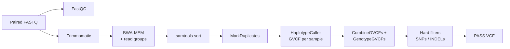

# Pigeon pea variant calling pipeline

A reproducible short-read variant calling pipeline (FastQC → Trimmomatic → BWA-MEM → MarkDuplicates → GATK HaplotypeCaller → joint genotyping → hard filtering), written in Bash. It was developed for whole-genome sequencing of 142 *Cajanus cajan* (pigeon pea) genotypes to identify SNPs and INDELs associated with photo-thermal insensitivity, at ICAR–Indian Institute of Pulses Research, Kanpur (2025).



## Repository layout

```
├── config/
│   ├── config.sh            # all settings: paths, threads, memory, tool names
│   └── samples.tsv          # sample sheet (example row)
├── scripts/
│   ├── vc_pipeline.sh       # per-sample: QC, trimming, alignment, duplicates, GVCF
│   └── joint_genotyping.sh  # all samples: joint genotyping + hard filtering
├── test/
│   ├── make_test_data.sh    # builds a small simulated dataset (3 samples)
│   ├── simulate_population.py
│   ├── config_test.sh       # settings for the test run
│   └── compare_to_truth.py  # checks calls against the simulated truth
├── environment.yml          # conda environment with tested tool versions
└── LICENSE
```

## Installation

```bash
git clone https://github.com/mish-sakshi/pigeonpea-variant-calling.git
cd pigeonpea-variant-calling
conda env create -f environment.yml
conda activate pigeonpea-vc
```

## Quick test (about 2 minutes, no real data needed)

```bash
bash test/make_test_data.sh                       # simulate 3 genotypes, ~40x, 250 kb genome
bash scripts/vc_pipeline.sh test/config_test.sh   # per-sample steps
bash scripts/joint_genotyping.sh test/config_test.sh
python3 test/compare_to_truth.py                  # compare with the simulated variants
```

Expected result:

| Type | Simulated | Called (PASS) | Recall | Precision |
|------|----------:|--------------:|-------:|----------:|
| SNP | 252 | 252 | 100% | 100% |
| INDEL | 48 | 48 | 100% | 100% |

Genotype concordance: 900/900 (100%). The simulated genome is random sequence with no repeats, so this checks that the pipeline runs correctly end to end; real genomes are harder.

## Running on your own data

1. **Reference.** Put the pigeon pea reference genome at `reference/pigeonpea_reference.fa` (or change `REF` in `config/config.sh`). BWA, samtools and GATK indexes are created automatically on the first run.
2. **Adapters.** Copy `TruSeq3-PE.fa` from your Trimmomatic installation into `adapters/`. In a conda environment it is in `$CONDA_PREFIX/share/trimmomatic/adapters/`.
3. **Reads.** List your samples in `config/samples.tsv` (tab-separated):

   ```
   sample_id    fastq_1                              fastq_2
   SRR12717516  raw_fastq/SRR12717516_1.fastq.gz     raw_fastq/SRR12717516_2.fastq.gz
   ```

   Public runs can be downloaded with `fasterq-dump --split-files SRR12717516 -O raw_fastq && gzip raw_fastq/*.fastq`.
4. **Run.**

   ```bash
   bash scripts/vc_pipeline.sh config/config.sh               # all samples
   bash scripts/vc_pipeline.sh config/config.sh SRR12717516   # or one sample (e.g. one per cluster job)
   bash scripts/joint_genotyping.sh config/config.sh
   ```

   Samples that already have a GVCF are skipped, so an interrupted run can simply be restarted.

If a tool has a different name on your system, override it without editing the code, for example:
`TRIMMOMATIC="java -jar /opt/trimmomatic-0.39.jar" bash scripts/vc_pipeline.sh config/config.sh`.

## Outputs

All outputs go to `results/` (set by `OUTDIR`).

| Path | Content |
|------|---------|
| `qc_reports/` | FastQC HTML reports for raw reads |
| `aligned_bam/<sample>_dedup.bam` | Sorted, duplicate-marked alignments (+ index) |
| `aligned_bam/<sample>_dup_metrics.txt` | Duplication rate per sample |
| `aligned_bam/<sample>_flagstat.txt` | Mapping statistics |
| `gvcf/<sample>.g.vcf.gz` | Per-sample GVCF |
| `variants/<cohort>.raw.vcf.gz` | Joint-genotyped variants before filtering |
| `variants/<cohort>.filtered.vcf.gz` | All variants with FILTER tags |
| `variants/<cohort>.PASS.vcf.gz` | **Final call set** (PASS only) |
| `variants/<cohort>.summary.tsv` | SNP and INDEL counts, raw vs PASS |
| `logs/` | One log file per tool and sample |

## Filtering

Pigeon pea has no truth/training variant set, so VQSR cannot be used. The pipeline applies GATK's recommended hard filters:

| Variant type | Filters (a variant failing any is flagged) |
|---|---|
| SNPs | QD < 2.0, QUAL < 30, SOR > 3.0, FS > 60.0, MQ < 40.0, MQRankSum < −12.5, ReadPosRankSum < −8.0 |
| INDELs | QD < 2.0, QUAL < 30, FS > 200.0, ReadPosRankSum < −20.0 |

For a population of 100+ samples, consider replacing `CombineGVCFs` with `GenomicsDBImport` (faster, run per chromosome).

## Annotation (optional, not included)

Variants were annotated with ANNOVAR, which cannot be redistributed. Obtain it from the ANNOVAR website, build a gene database from the pigeon pea GFF3 annotation, then run, for example:

```bash
gff3ToGenePred pigeonpea.gff3 ccdb/Cc_refGene.txt
retrieve_seq_from_fasta.pl --format refGene --seqfile reference/pigeonpea_reference.fa \
    ccdb/Cc_refGene.txt --out ccdb/Cc_refGeneMrna.fa
zcat results/variants/pigeonpea_cohort.PASS.vcf.gz > cohort.PASS.vcf
table_annovar.pl cohort.PASS.vcf ccdb/ -buildver Cc -protocol refGene -operation g -vcfinput -out results/annotation/cohort
```

## Data availability

The sequencing data (142 genotypes) were generated at ICAR–Indian Institute of Pulses Research and are not included in this repository. Use `test/` to try the pipeline.

## Tested with

FastQC 0.12.1, Trimmomatic 0.39, BWA 0.7.17, samtools 1.19.2, GATK 4.6.1.0 (Java 21), on Linux.

## Citation

If you use this pipeline, please cite the tools it relies on: FastQC, Trimmomatic (Bolger et al. 2014), BWA-MEM (Li 2013), SAMtools (Danecek et al. 2021) and GATK (McKenna et al. 2010; Van der Auwera & O'Connor 2020).

## Author

Sakshi Mishra · [GitHub](https://github.com/mish-sakshi) · [LinkedIn](https://www.linkedin.com/in/sakshi-mishra-8aa713212/)
